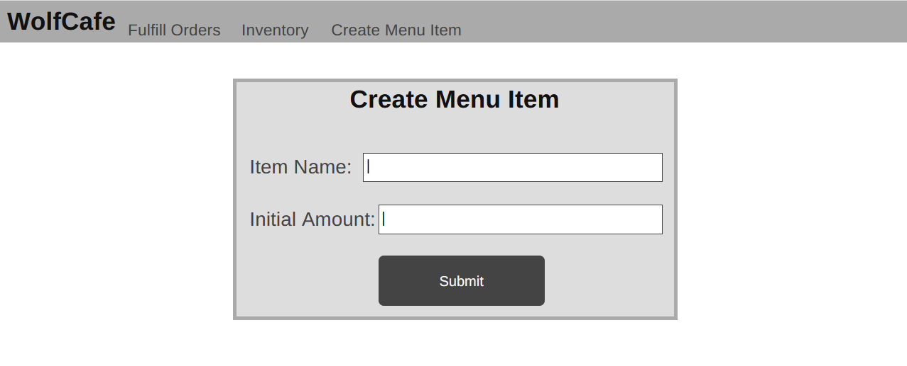
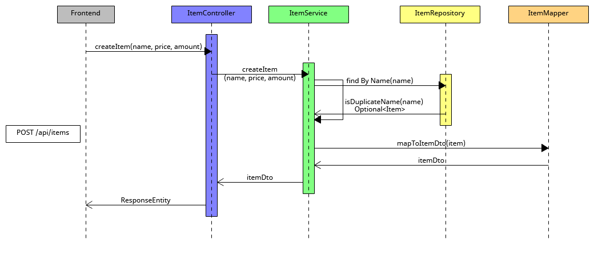
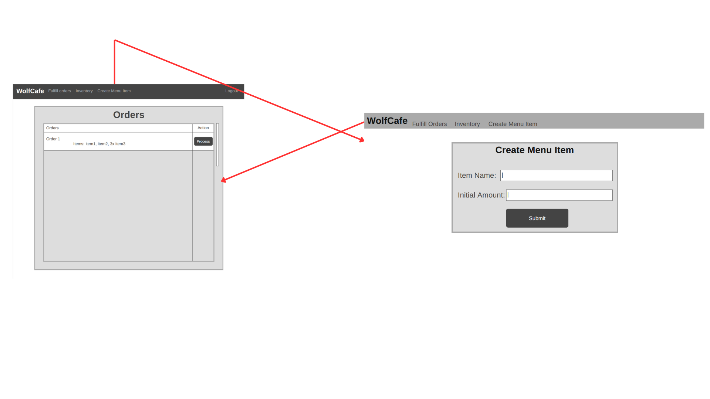

# Feature Design: UC10 Create Item

**Use Cases:** [UC10](../requirements/use-cases/uc10-staff-create-item.md)

**Owners:** Raina Yowell (rwyowell/i1A-design-staff-create-item, rwyowell/i1B-UC10&UC11-FrontendImplementation), Shreya Kaamath (iteration1B-backend)

## Static Design

### Backend: Class Diagram

Important Classes:
- Item
- ItemController
- ItemRepository
- ItemService
- ItemServiceImpl
- ItemDto

### Frontend: Wireframes

- Accepts an item name
- Accepts item initial amount
- Submit button

## Dynamic Design

### Backend: Sequence Diagram

### Frontend: Navigation Map

## Design Decisions

This feature implements the items into the system. This means all item classes will be touched. 
The Item class will be used to create a new item object, the ItemController will be used to handle the request and response, 
the ItemRepository will be used to save the new item to the database, the ItemService and ItemServiceImpl will be used to handle 
the business logic, and the ItemDto will be used to transfer data between the frontend and backend. The implementation will
look similar to the Coffee Maker ingredient functionality.

## REST API

[REST API](rest-api.md)

- adds POST /api/items

## Changes During Implementation

TODO - At final delivery, describe how the design changed during implementation, with updated diagrams, or say that you followed it as designed.
