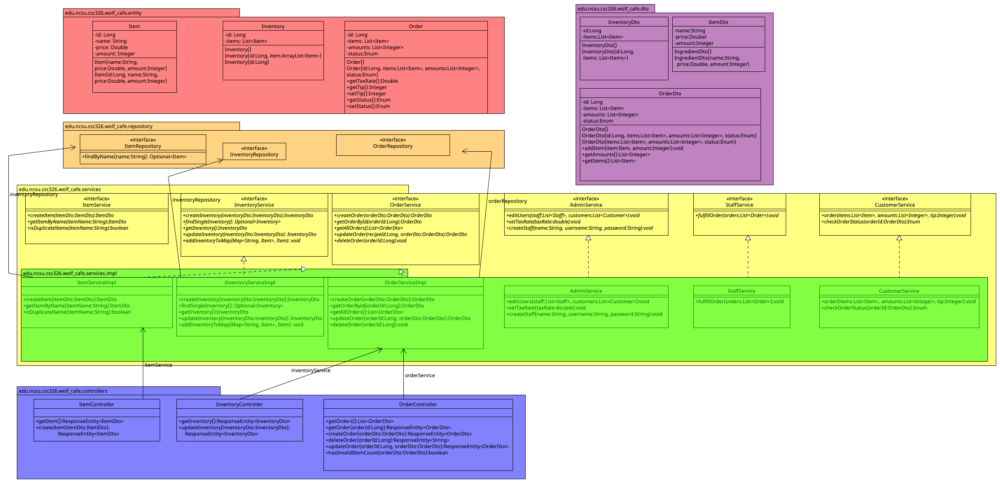
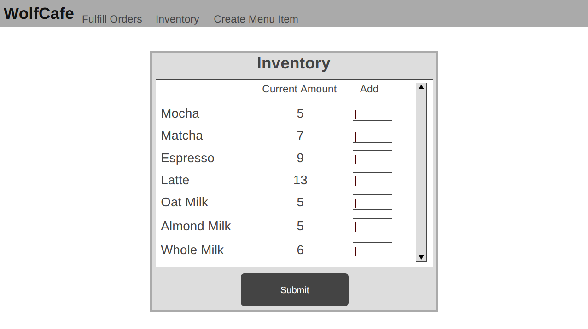
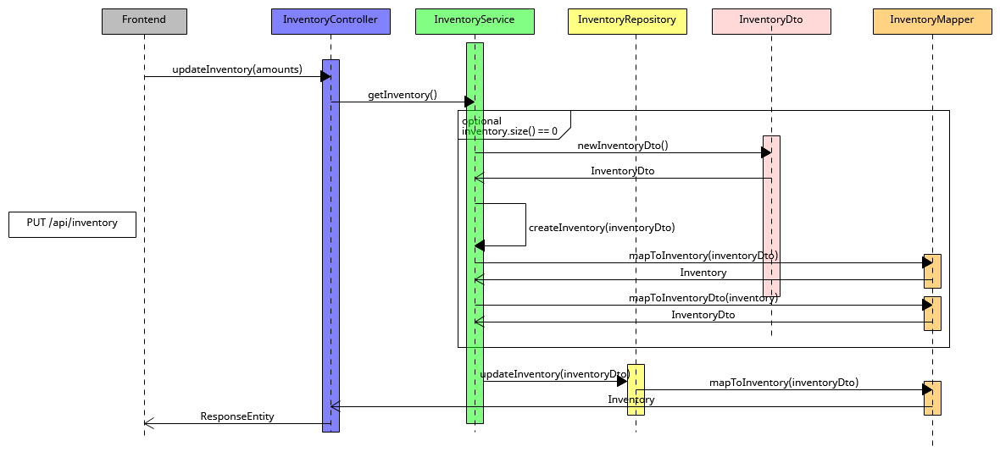
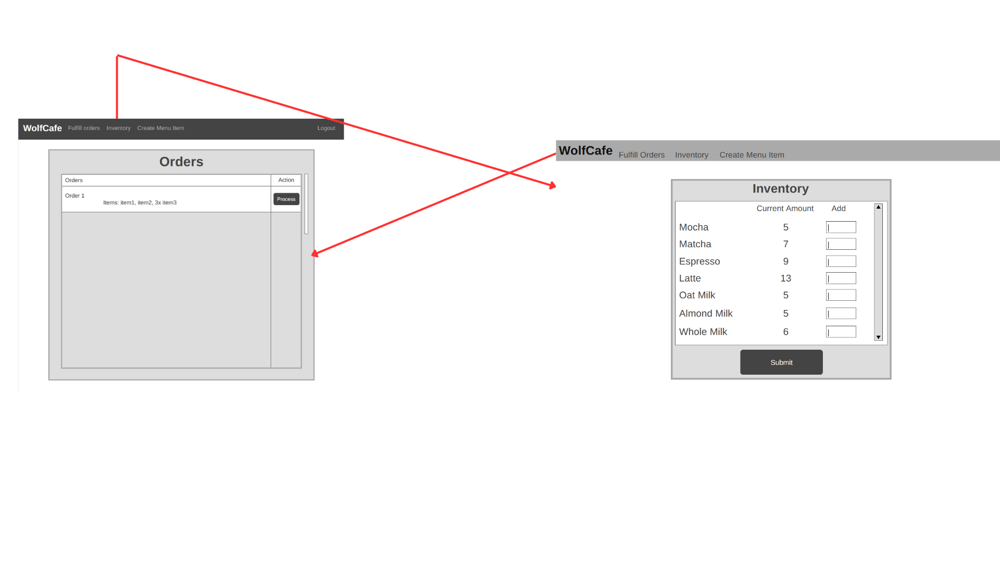

# Feature Design: UC11 Update Inventory

**Use Cases:** [UC11](../requirements/use-cases/uc11-staff-update-inventory.md)

**Owners:** Raina Yowell (rwyowell/i1A-design-staff, rwyowell/i1B-UC10&UC11-FrontendImplementation), Shreya Kaamath (iteration1B-backend)

## Static Design

### Backend: Class Diagram

Important Classes:
- Inventory
- InventoryController
- InventoryRepository
- InventoryService
- InventoryServiceImpl
- InventoryDto

### Frontend: Wireframes

- Shows list of existing items on menu
- Shows current amount of each item
- Accepts amount to add to each inventory item

## Dynamic Design

### Backend: Sequence Diagram

### Frontend: Navigation Map

## Design Decisions

This feature implements the inventory into the system. This means all inventory classes will be touched.
The Inventory class will be used to create a new inventory object, the InventoryController will be used 
to handle the request and response of updating the inventory, the InventoryRepository will be used to save the new inventory to the database, 
the InventoryService and InventoryServiceImpl will be used to handle the business logic, and the InventoryDto 
will be used to transfer data between the frontend and backend. The implementation will look similar to the Coffee 
Maker inventory functionality.

## REST API

[REST API](rest-api.md)
PUT /api/inventory
GET /api/inventory

## Changes During Implementation

TODO - At final delivery, describe how the design changed during implementation, with updated diagrams, or say that you followed it as designed.
