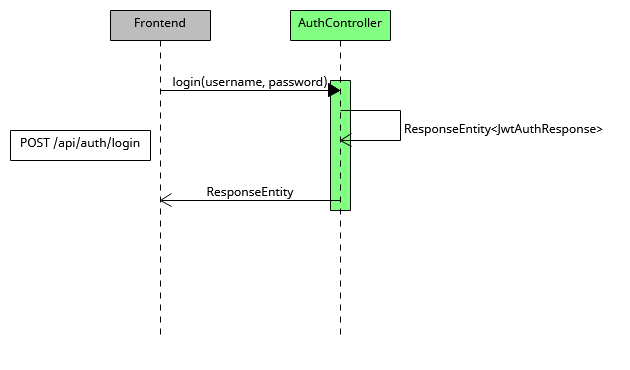

# Feature Design: UC1 Customer Menu

Copy this file to `feature-short-name.md` for each feature-based role's design, fill it in, and link it from the [Design](index.md) page.  Write the design on its own document branch, such as `docs-i1a-design-orders`; corrections found later while implementing go on the feature branch with the code.  See [Technical Document Branches](../github-process.md#technical-document-branches).  Delete these instructions from your copy.

Save diagram and wireframe images in an `images` folder next to this file and embed them with Markdown, for example ``.

**Use Cases:** [UC1](../requirements/use-cases/uc1-customer-view-menu.md)

**Owners:** Raina Yowell (rwyowell/i2A-CustomerDesign)

## Static Design

### Backend: Class Diagram

Important Classes:
- UserDto
- LoginDto
- User

### Frontend: Wireframes

## Dynamic Design

### Backend: Sequence Diagram

### Frontend: Navigation Map

Login Page -> WireframeUC1

## Design Decisions

The only classes getting to the main menu touches are the login classes. The UserDto and LoginDto are used to transfer data between the frontend and backend. 
The User class is used to represent the user in the system. The login classes will be used to authenticate the user and allow them to access the correct main menu.

## REST API

[REST API](rest-api.md)
POST /api/auth/login

## Changes During Implementation

TODO - At final delivery, describe how the design changed during implementation, with updated diagrams, or say that you followed it as designed.
