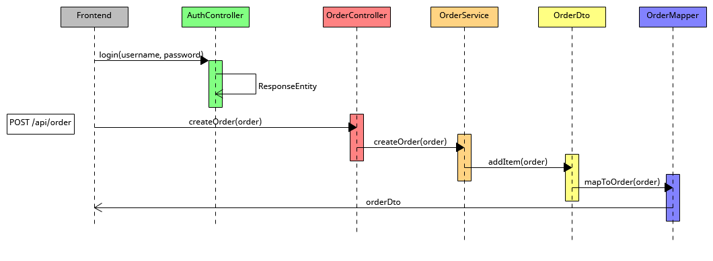

# Feature Design: UC2 Customer Order

**Use Cases:** [UC2](../requirements/use-cases/uc2-cutomer-order.md)

**Owners:** Raina Yowell (rwyowell/i2A-CustomerDesign), Lucas Correa

## Static Design

### Backend: Class Diagram

Important Classes:
- OrderController
- OrderDto
- Order
- OrderMapper
- OrderRepository
- OrderService
- OrderServiceImpl

### Frontend: Wireframes

## Dynamic Design

### Backend: Sequence Diagram

### Frontend: Navigation Map

Login Page -> WireframeUC1 -> WireframeUC2

## Design Decisions

The customer ordering process is implemented through all the order classes. The OrderController handles the request and response of the order being placed,
the OrderDto transfers data between the frontend and backend, the Order class maintains the order information, the OrderMapper maps the order datato the database.
the Order Repository saves the order to the database, and the Service classes handle the general logic of how the order is processed. This implementation
shares similarities with the Coffee Maker Make Recipe functionality.

## REST API

[REST API](rest-api.md)
POST /api/orders

## Changes During Implementation

TODO - At final delivery, describe how the design changed during implementation, with updated diagrams, or say that you followed it as designed.
