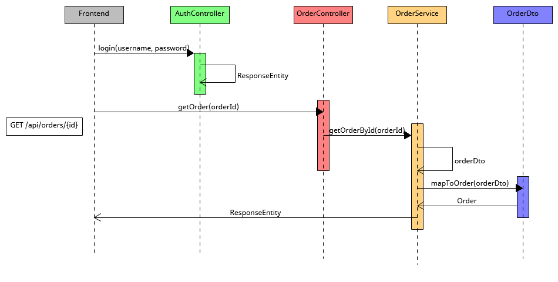

# Feature Design: UC3 Customer Pickup Status

**Use Cases:** [UC3](../requirements/use-cases/uc3-cutomer-pickup-status.md)

**Owners:** Raina Yowell (rwyowell/i2A-CustomerDesign)

## Static Design

### Backend: Class Diagram

Important Classes:
- Order
- OrderStatus
- OrderService
- OrderSerivceImpl

### Frontend: Wireframes

## Dynamic Design

### Backend: Sequence Diagram

### Frontend: Navigation Map

Login Page -> WireframeUC1 -> WireframeUC3

## Design Decisions

The customer pickup status feature is implemented through the order classes. The Order class maintains the order information, 
the OrderStatus class maintains the status of the order, and the Service classes handle the general logic of how the order status 
is retrieved. This implementation is a new functionality, but easily builds on the order class. 

## REST API

[REST API](rest-api.md)
GET /api/orders/{id}/status

## Changes During Implementation

TODO - At final delivery, describe how the design changed during implementation, with updated diagrams, or say that you followed it as designed.
