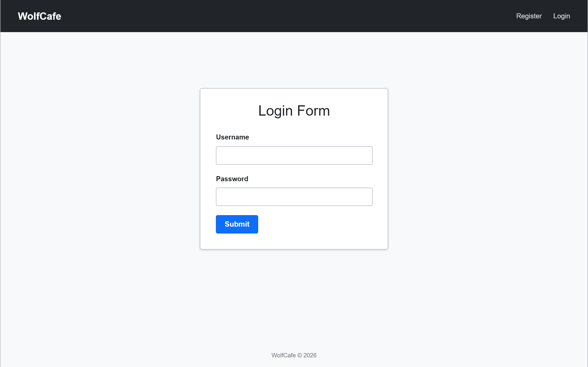
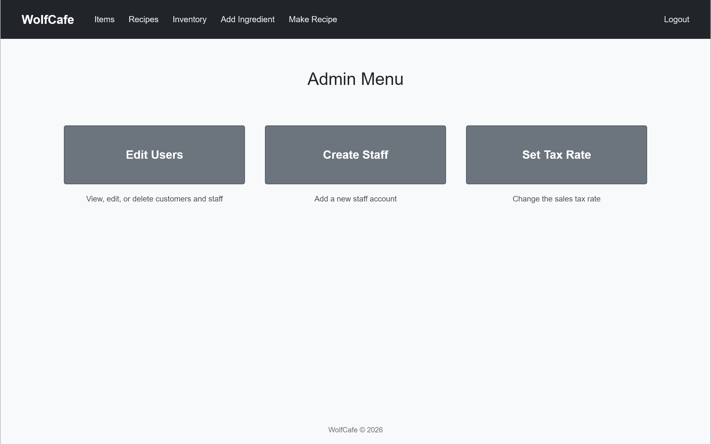
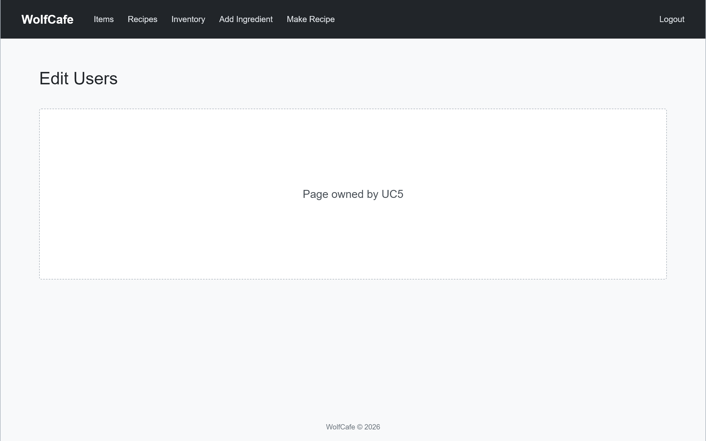
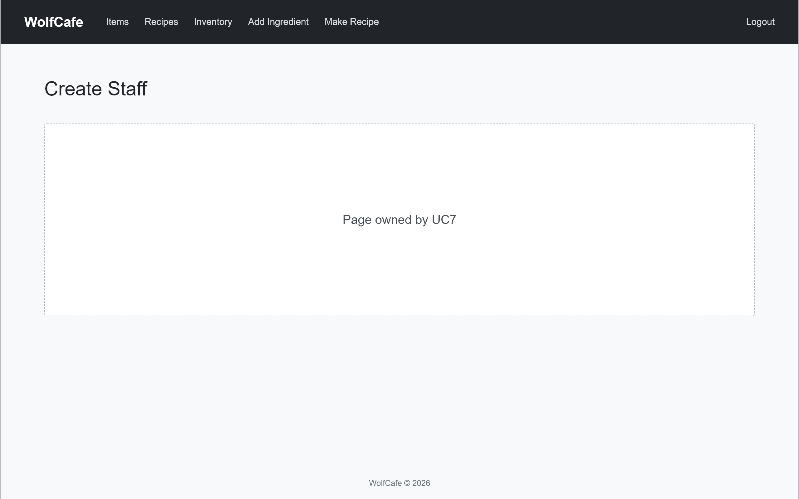
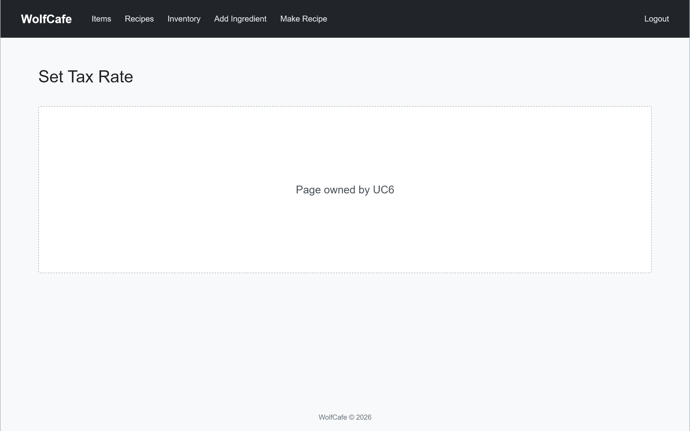
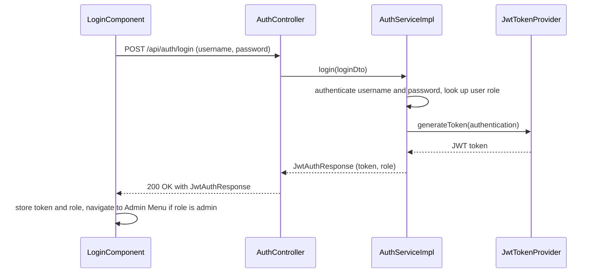

# Feature Design: UC4 Admin Menu

**Use Cases:** [UC4: Admin View Menu](../requirements/use-cases/uc4-admin-view-menu.md)

**Owners:** Shion Strickland (shstric2): frontend and backend. Branches: `shstric2/uc4_frontend-entry` (code), `shstric2/i1A-design-uc4` (this document).

## Static Design

### Backend: Class Diagram
No classes are added, edited, or removed. UC4 reuses the existing authentication classes: AuthController, AuthServiceImpl, JwtTokenProvider, and JwtAuthResponse.

### Frontend: Wireframes

Login: the user enters a username and password and clicks Submit. An admin is then taken to the Admin Menu.

Admin Menu: shows three options: Edit Users (UC5), Create Staff (UC7), and Set Tax Rate (UC6). This page is only available to admins.

Edit Users: the real page is built by UC5.

Create Staff: the real page is built by UC7.

Set Tax Rate: the real page is built by UC6.

## Dynamic Design

### Backend: Sequence Diagram

UC4 adds no new backend calls, since the role already arrives in the login response.

### Frontend: Navigation Map

Login → Admin Menu → Edit Users / Create Staff / Set Tax Rate

## Design Decisions

- **A single Admin Menu page.** Admin features (Edit Users, Create Staff, Set Tax Rate) are reached from one landing page after login, so an admin does not need to remember or type separate URLs.
- **Admin-only access.** The menu is shown only to users with the admin role, so staff and customers never see admin options.
- **Frontend only.** The menu is just a page of links to other use cases, so it needs no new backend classes or endpoints. Login and role information come from the existing authentication flow.
- **Placeholder pages.** The three destination pages are wireframed here, but each is built by its own use case (UC5, UC6, UC7). This keeps UC4 small and avoids overlapping work.

## REST API

UC4 adds no endpoints, because the menu is a frontend page.

## Changes During Implementation

TODO - At final delivery, describe how the design changed during implementation, with updated diagrams, or say that you followed it as designed.
