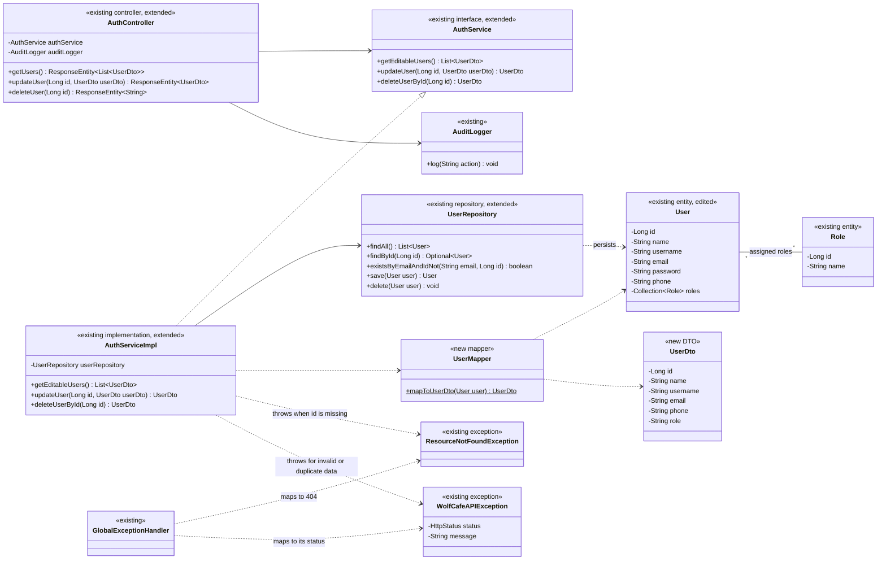
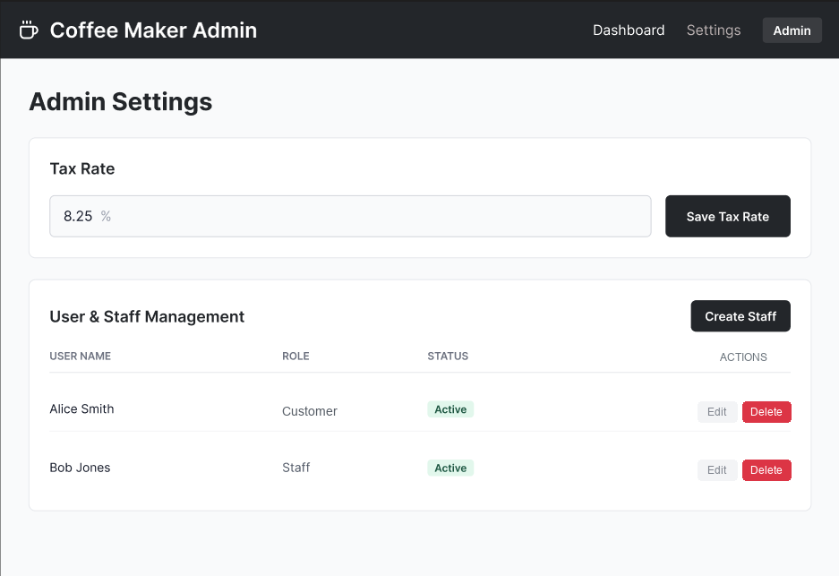
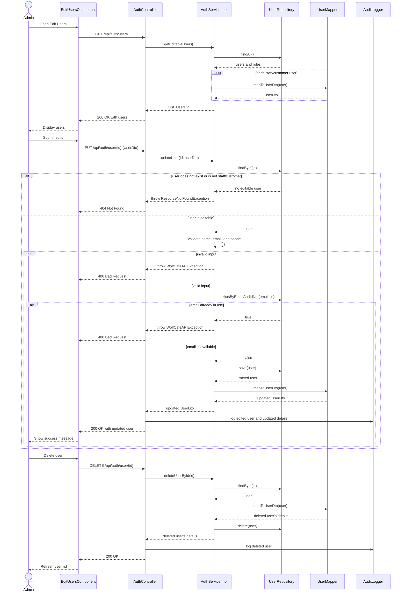

# Feature Design: UC5 Admin Edit Users

**Use Cases:** [UC5: Admin Edit Users](../requirements/use-cases/uc5-admin-edit-users.md)

**Owners:** Lylan Bui (labui): frontend and backend. Branches: `labui/i1a-design-uc5` (this document)

## Static Design

### Backend: Class Diagram

UC5 reuses the existing authentication service and controller, which already has user deletion. It adds a safe user DTO and mapper, adds a phone field to the existing `User` entity, and extends the existing service and repository for listing and updating staff and customer accounts.



Existing classes to edit: `User` (persist `phone`), `UserRepository` (email uniqueness check excluding the current user), `AuthService` / `AuthServiceImpl` (list, update, and return the deleted user's details), and `AuthController` (list and update endpoints, plus contextual audit messages for update and delete). New classes: `UserDto` and `UserMapper`. The DTO must never include the password or password hash.

### Frontend: Wireframes




The User & Staff Management section lists customer and staff accounts. Each row has Edit and Delete actions; selecting Edit opens the user's information for changes, while Delete removes the account.


## Dynamic Design

### Backend: Sequence Diagram

The sequence shows the main list, edit, and delete flows. Each endpoint is restricted to Admin users.



### Frontend: Navigation Map

Login → Admin Menu → Edit Users list → Select Edit → Edit User form → Submit → Edit Users list with success message

From the Edit Users list, selecting Delete removes that user and refreshes the list. If required information is invalid, the admin remains on the edit form to correct it. If the selected user was deleted before the edit is saved, the admin returns to the list with an error message.


## Design Decisions

- **Editable user information.** Admins can update a user's name, email, and phone. Username, role, and password remain unchanged; `UserDto` excludes the password.
- **Staff and customer accounts.** The list, edit, and delete operations are limited to staff and customers, not admins. `User` gains a phone field to support UC5's edit form and audit message; required fields, email format, phone format, and email uniqueness are validated.
- **Reuse existing user management.** `AuthController`, `AuthServiceImpl`, and `UserRepository` already support deleting users, so UC5 extends these classes for listing and editing rather than adding a separate user-management layer.
- **Admin-only access and audit logging.** All endpoints require the Admin role. Successful edits and deletions are recorded with the existing `AuditLogger`; passwords and other secrets are never logged.
- **Existing error handling.** Missing or non-editable users return 404, while invalid data or duplicate email returns 400 through the existing exception handling.

## REST API

All three endpoints require a valid login and the Admin role. A missing/invalid token returns 401; an authenticated non-admin receives 403. Record the new endpoints and the UC5 use of the existing delete endpoint in the team's [REST API](rest-api.md).

| Method | Path | Roles | Request Body | Responses |
|--------|------|-------|------------|-----------|
| GET | `/api/auth/users` | Admin |  | 200 OK with `List<UserDto>` containing staff and customers only |
| PUT | `/api/auth/user/{id}` | Admin | `UserDto`: name, email, phone | 200 OK with the updated `UserDto`; 400 if fields are missing/invalid or email is already in use; 404 if the id is missing or not a staff/customer account |
| DELETE | `/api/auth/user/{id}` | Admin |  | Existing endpoint: 200 OK; 404 if the id is missing or not a staff/customer account |

Example update request:

```json
{
  "name": "Jane Doe",
  "email": "jdoe@example.com",
  "phone": "828-888-8282"
}
```
## Changes During Implementation

Implementation follows this design: the existing authentication API lists, edits, and deletes only staff/customer accounts. Edits validate required profile fields and duplicate email; responses use a password-free `UserDto`.
