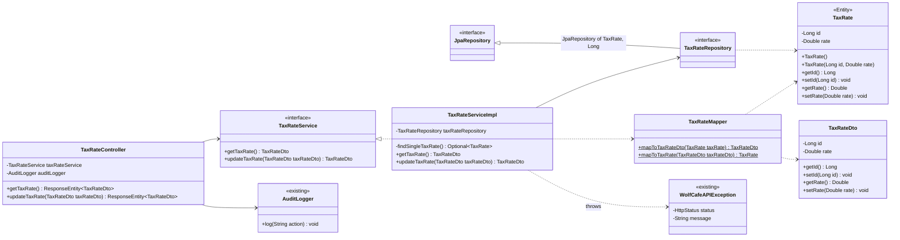
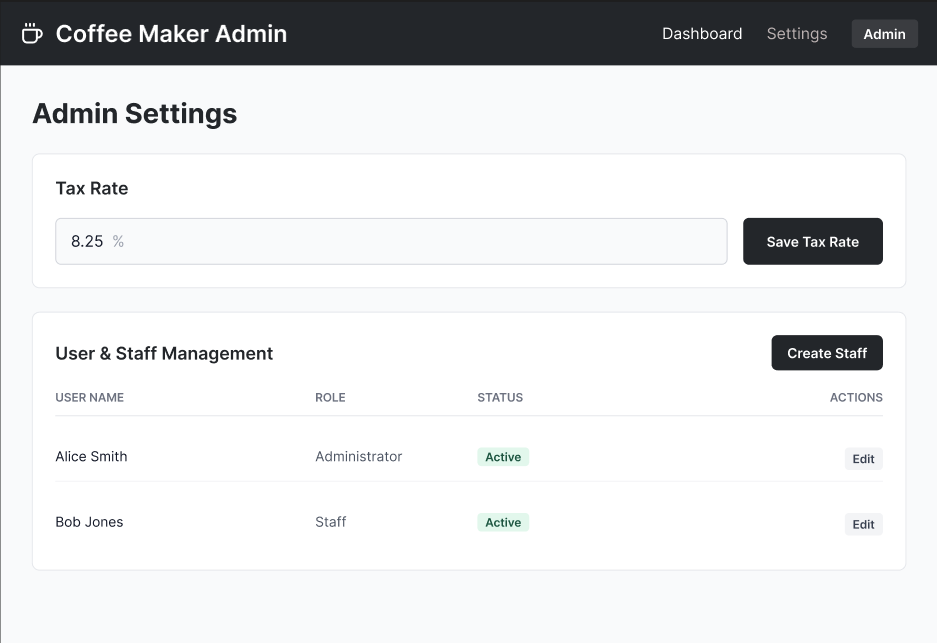
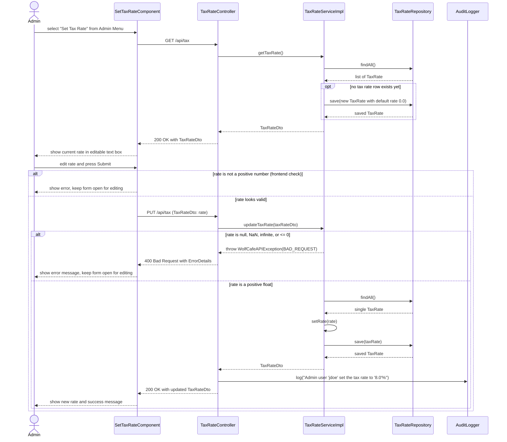

# Feature Design: UC6 Set Tax Rate


**Use Cases:** [UC6: Admin Set Tax Rate](../requirements/use-cases/uc6-admin-set-tax-rate.md)

**Owners:** Sandra Jose (sajose): frontend and backend. Branches: `sajose/i1a-design-uc6` (this document)

## Static Design

### Backend: Class Diagram

UC6 adds a new tax rate that follows the same pattern as Inventory: one entity stored as a single row, with a repository, service, mapper, DTO, and controller. No existing classes are edited or removed. The controller uses the existing `AuditLogger`, and bad input is reported with the existing `WolfCafeAPIException`, which `GlobalExceptionHandler` already turns into an error response.



New classes:
- `TaxRate` (entity): the single row holding the current tax rate as a percent, e.g. `8.0` for 8%.
- `TaxRateDto`: carries the rate between the frontend and backend.
- `TaxRateMapper`: converts between `TaxRate` and `TaxRateDto`.
- `TaxRateRepository`: JPA repository for `TaxRate`.
- `TaxRateService` / `TaxRateServiceImpl`: gets the single rate (creating it with a default if none exists) and validates and saves updates.
- `TaxRateController`: REST endpoints at `/api/tax`; logs each successful update.

Frontend additions: `SetTaxRateComponent.jsx` (the page) and `TaxRateService.js` (axios calls to `/api/tax`).

### Frontend: Wireframes




Set Tax Rate: the page loads the current tax rate into an editable text box. When the admin presses Save Tax Rate, the new rate is saved and a success message is shown. If the value is not a positive number, an error message appears under the text box and the admin can fix the value.

## Dynamic Design

### Backend: Sequence Diagram



### Frontend: Navigation Map

Login → Admin Menu → Set Tax Rate → (Save Tax Rate) → Set Tax Rate with the saved rate, or with an error message to fix

The admin can also reach Set Tax Rate (`/set-tax-rate`) from any page through the **Settings** tab in the header, which only the admin sees.

## Design Decisions

- **Singleton entity.** There is only one tax rate for the whole cafe, so it is stored as a single `TaxRate` row. `TaxRateServiceImpl` finds it by reading the only row (`findAll().stream().findFirst()`) rather than a hard-coded id, the same way `InventoryServiceImpl` does.
- **Default rate.** If no row exists yet, `getTaxRate()` creates one with a rate of `0.0` so the page always has a value to show. An admin must then set a positive rate.
- **Rate is stored as a percent.** `8.0` means 8%, matching both what the admin types and the log message. Code that computes order totals later divides by 100.
- **Admin-only updates, wider reads.** Only admins can `PUT` the rate. `GET` is open to Admin, Staff, and Customer because placing and paying for orders in later use cases needs the rate to compute tax.

## REST API

See [REST API](rest-api.md). UC6 adds:

| Method | Path       | Roles                  | Request Body       | Responses                                                                                      |
|--------|------------|------------------------|--------------------|------------------------------------------------------------------------------------------------|
| GET    | `/api/tax` | Admin, Staff, Customer |                    | 200 OK with `TaxRateDto`: id, rate (creates the rate with a default of 0.0 if none exists yet) |
| PUT    | `/api/tax` | Admin                  | `TaxRateDto`: rate | 200 OK with the updated `TaxRateDto`; 400 if the rate is missing or not a positive number      |

Example `PUT /api/tax` request body:

```json
{ "rate": 8.0 }
```

Example 400 response:

```json
{
  "timeStamp": "2026-10-28T14:03:11.512",
  "message": "Tax rate must be a positive number.",
  "details": "uri=/api/tax"
}
```

## Changes During Implementation

TODO - At final delivery, describe how the design changed during implementation, with updated diagrams, or say that you followed it as designed.
