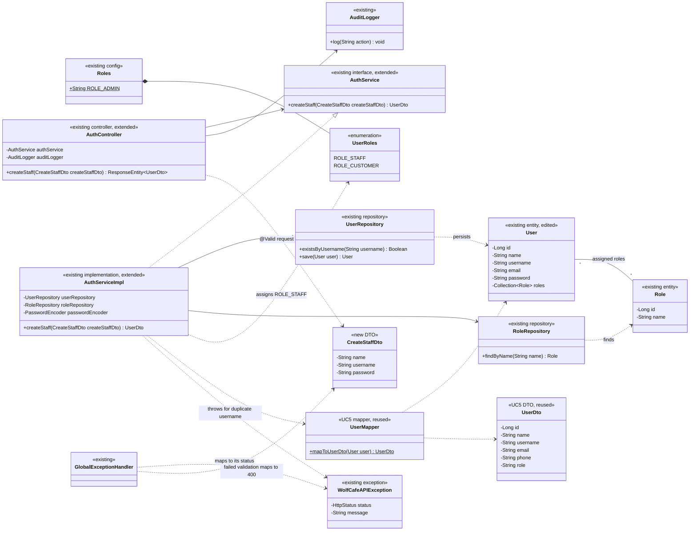
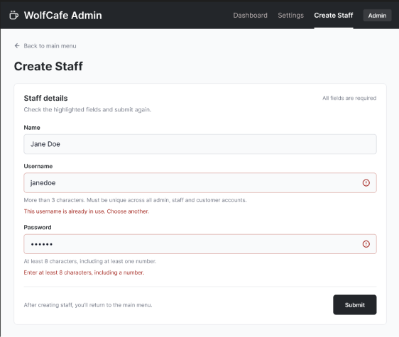
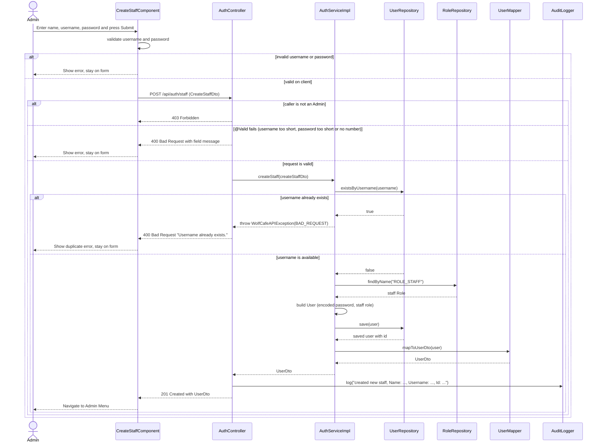

# Feature Design: UC7 Admin Create Staff

**Use Cases:** [UC7: Admin Create Staff](../requirements/use-cases/uc7-admin-create-staff.md)

**Owners:** sajose: frontend and backend. Branches: `sajose/i1a-design-uc7` (this document)

## Static Design

### Backend: Class Diagram

UC7 reuses the existing authentication service and controller, which already register customers. It adds a `CreateStaffDto` for the request, reuses the `UserDto` and `UserMapper` designed in [UC5](uc5-admin-edit-users.md) for the response, and extends the existing service and controller with a staff-creation operation.



Existing classes to edit: `User` (`email` becomes nullable, since UC7 does not collect one; it stays unique), `AuthService` / `AuthServiceImpl` (add `createStaff`), and `AuthController` (add the endpoint and its audit message). New class: `CreateStaffDto`, with bean validation annotations for the username and password rules. `UserRepository`, `RoleRepository`, `Roles`, `AuditLogger`, and `GlobalExceptionHandler` are used unchanged.

`CreateStaffDto` validation:

| Field      | Annotations                                                   | Rule from UC7                                                     |
|------------|---------------------------------------------------------------|-------------------------------------------------------------------|
| `name`     | `@NotBlank`                                                   | name is required                                                  |
| `username` | `@NotBlank`, `@Size(min = 4)`                                 | [Invalid Username]: more than 3 characters                        |
| `password` | `@NotBlank`, `@Size(min = 8)`, `@Pattern(regexp = ".*\\d.*")` | [Invalid Password]: at least 8 characters and at least one number |

### Frontend: Wireframes

The Create Staff page is a form with Name, Username, and Password inputs, a Submit button, and a Cancel button that returns to the Admin Menu. Validation errors appear under the field they belong to; a duplicate username error from the server appears under the Username field.




## Dynamic Design

### Backend: Sequence Diagram

The sequence starts when the admin submits the form. The endpoint is restricted to Admin users.



### Frontend: Navigation Map

Login → Admin Menu → Create Staff form → Submit → Admin Menu

If any field is invalid or the username is taken, the admin stays on the Create Staff form with the error shown. Cancel returns to the Admin Menu without creating a user.

## Design Decisions

- **Reuse existing user management.** `AuthController.register()` and `AuthServiceImpl.register()` already create customers, so UC7 adds a parallel `createStaff` operation in the same classes rather than a new controller. The only difference from registration is the role (`ROLE_STAFF`), the Admin-only access, and the fields collected.
- **Separate request DTO.** `RegisterDto` requires an email and is used by the public registration page, so UC7 adds `CreateStaffDto` (name, username, password) rather than loosening `RegisterDto`'s meaning. Its bean validation annotations enforce the UC7 rules, and the existing `GlobalExceptionHandler` turns failures into 400 responses with the field's message.
- **Nullable email.** `User.email` is currently `nullable = false`, but UC7 does not collect one. The column becomes nullable (still unique; multiple `NULL`s are allowed). Customer registration still requires and checks email, and login by username is unaffected.
- **Reuse UC5's `UserDto`.** The response uses the `UserDto` and `UserMapper` from UC5 so the frontend gets the new staff member's id without the password. UC7 depends on UC5 landing these classes first; coordinate with the UC5 owner.
- **Duplicate username returns 400.** This matches the existing `register` endpoint and UC5. The check is done in the service with `existsByUsername`, which covers every user, not only staff, because the `username` column is unique across all users.
- **Validation in both layers.** `CreateStaffComponent` checks the same rules before submitting so the admin gets immediate feedback; the backend validation is the authority.
- **Audit logging without the password.** `AuditLogger` must never record passwords or other secrets, so UC7's logging section was updated to drop the password from its example. The log entry records the admin (supplied by `AuditLogger.log(String)`), their role, and `created new staff, Name: 'Jane Doe', Username: 'janedoe', Id: 8`.
- **Frontend.** Add `CreateStaffComponent` at route `/create-staff` inside the authenticated routes, linked from the UC4 Admin Menu, and `createStaffAPICall(staffObj)` in `AuthService.js`.

## REST API

The endpoint requires a valid login and the Admin role. A missing/invalid token returns 401; an authenticated non-admin receives 403. Recorded in the team's [REST API](rest-api.md).

| Method | Path | Roles | Request Body | Responses |
|--------|------|-------|--------------|-----------|
| POST | `/api/auth/staff` | Admin | `CreateStaffDto`: name, username, password | 201 Created with the new staff member's `UserDto`; 400 if the name is blank, the username is 3 characters or fewer, the password is shorter than 8 characters or has no number, or the username already exists |

Example request:

```json
{
  "name": "Jane Doe",
  "username": "janedoe",
  "password": "JaneDoe8"
}
```

Example response (201 Created):

```json
{
  "id": 8,
  "name": "Jane Doe",
  "username": "janedoe",
  "email": null,
  "phone": null,
  "role": "ROLE_STAFF"
}
```

Example error (400 Bad Request):

```json
{
  "timeStamp": "2026-10-28T14:03:11",
  "message": "Username already exists.",
  "details": "uri=/api/auth/staff"
}
```

## Changes During Implementation

Implementation follows this design: staff creation uses a separate validated request DTO, assigns `ROLE_STAFF`, encodes the password, and returns the password-free `UserDto` shared with UC5.
