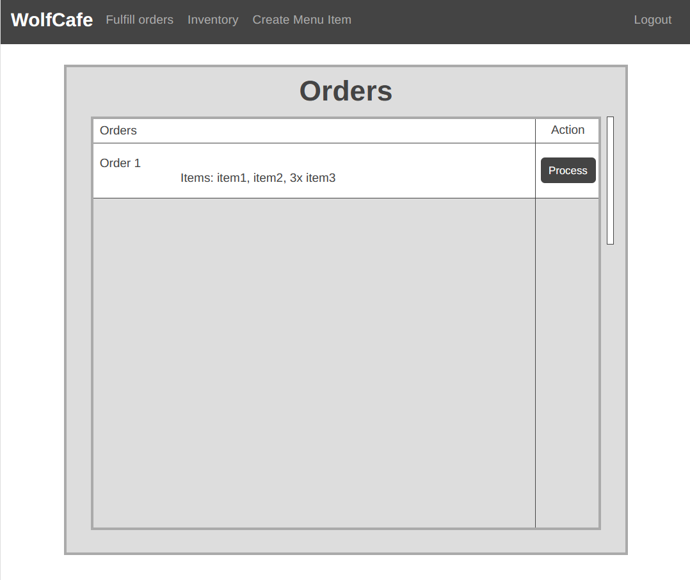
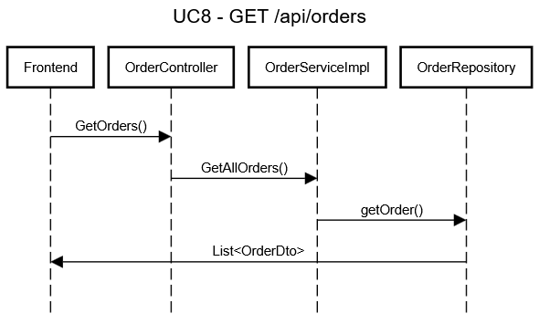

# Feature Design: UC8 Staff View Orders

**Use Cases:** [UC8: Staff View Orders](../requirements/use-cases/uc8-staff-view-menu.md)

**Owners:** Lucas (lccorrea): frontend design | Branch: lccorrea/1a-frontend-design 

## Static Design

### Backend: Class Diagram

Relevant classes:
- Order
- OrderDto
- OrderServiceImpl
- OrderController

### Frontend: Wireframes

## Dynamic Design

### Backend: Sequence Diagram

### Frontend: Navigation Map

There is no navigation for this feature. Everything is handled in one page

## Design Decisions

Order - Creates order entity with items, amounts, and status
OrderServiceImpl - Handles a list of order objects, such as creating, deleting, editing, and looking up orders by name
OrderController - Handle API endpoints, such as POST, GET and DELETE orders

## REST API

[REST API](../design/rest-api.md)
- GET /api/orders
- GET /api/orders/{id}
- POST /api/orders
- DELETE /api/orders/{id}
- PUT /api/orders/{id}

## Changes During Implementation

TODO - At final delivery, describe how the design changed during implementation, with updated diagrams, or say that you followed it as designed.
